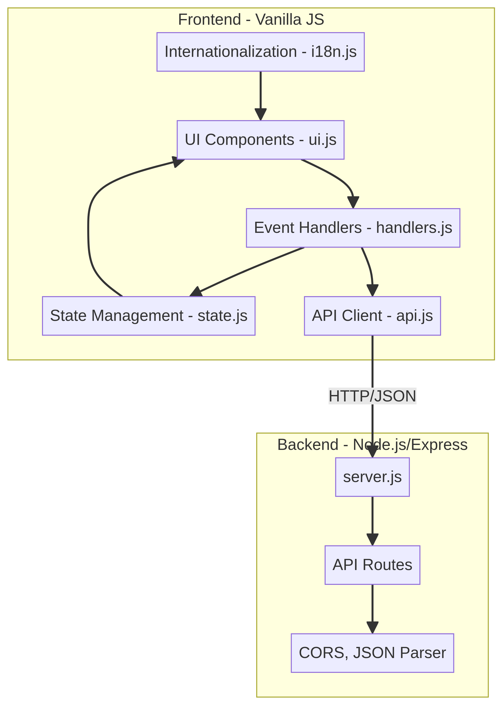
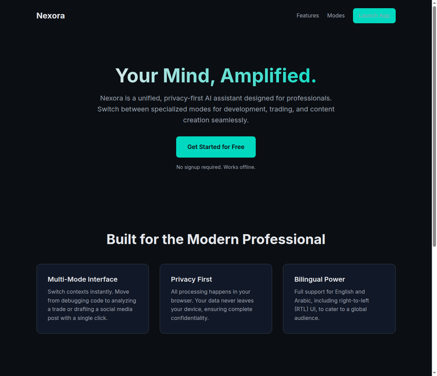
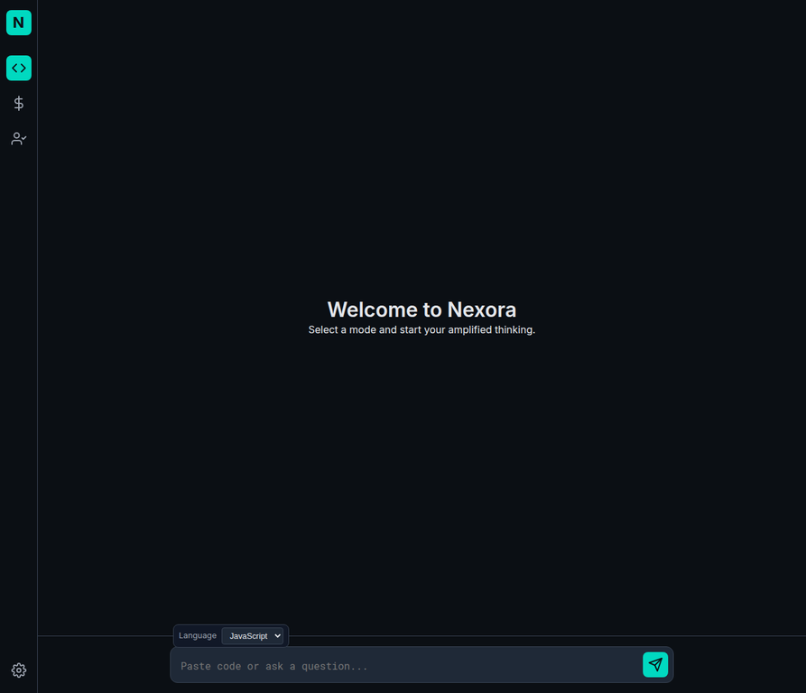
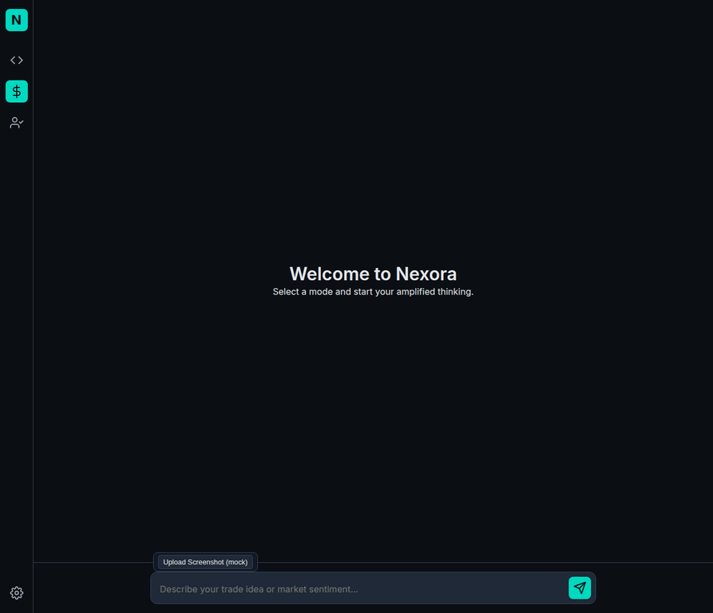
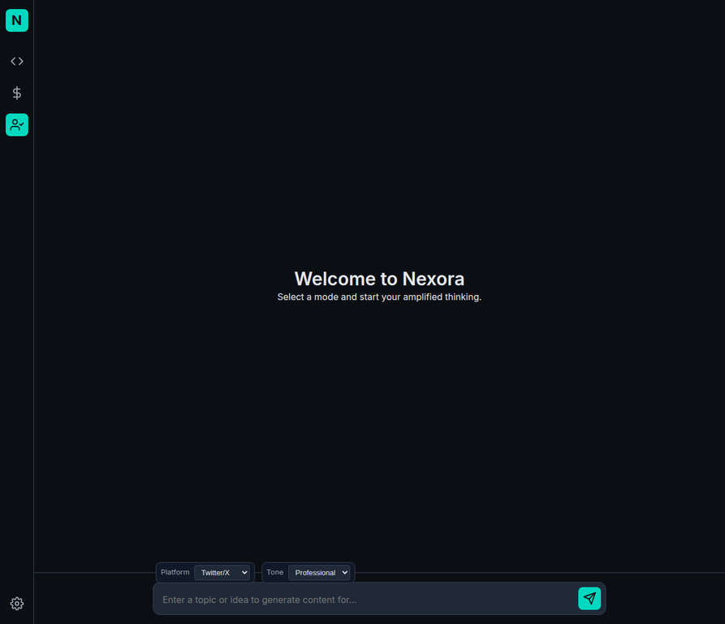

# 🌌 Nexora - Your Mind, Amplified

**Nexora** is a professional, multi-mode AI assistant designed to streamline workflows for developers, traders, and content creators. Built with a privacy-first approach, Nexora offers a unified interface for complex tasks, supporting both English and Arabic with a full RTL (Right-to-Left) user experience.

---

## 🏗️ Architecture

Nexora follows a modern, decoupled architecture ensuring security and performance.



### **Core Components**
- **Frontend (Vanilla JS)**: A lightweight, modular frontend using a reactive state management pattern.
- **State Management**: Centralized state handling (`state.js`) ensuring UI consistency.
- **i18n System**: Built-in support for multi-language switching (English/Arabic).
- **Secure Backend (Node.js/Express)**: A robust server-side proxy that handles API communication securely, keeping sensitive keys protected.
- **AI Integration**: Powered by advanced LLMs via secure API endpoints.

---

## 📸 Screenshots

### **Landing Page**
A clean, professional entry point highlighting Nexora's core value propositions.


### **Developer Mode**
Optimized for code analysis, debugging, and pair programming.


### **Trader Mode**
Focused on market sentiment analysis and trading psychology.


### **Social Content Mode**
Generate platform-specific content for Twitter, LinkedIn, and more.


---

## 🚀 Key Features
- **Multi-Mode Interface**: Switch contexts instantly between Dev, Trade, and Social modes.
- **Privacy-First**: Secure handling of data and API keys through a dedicated backend proxy.
- **Bilingual Support**: Seamless transition between English and Arabic (RTL support).
- **Responsive Design**: Modern, dark-themed UI optimized for all screen sizes.

---

## 🛠️ Getting Started

### **Prerequisites**
- **Node.js 18+**
- **npm** or **yarn**

### **Installation & Setup**
1. **Clone the repository**:
   ```bash
   git clone https://github.com/YOUR_USERNAME/nexora.git
   cd nexora
   ```

2. **Backend Configuration**:
   Navigate to the server directory and set up your environment variables:
   ```bash
   cd server
   cp .env.example .env
   # Open .env and add your API_KEY
   ```

3. **Install Dependencies**:
   ```bash
   npm install
   ```

4. **Run the Application**:
   ```bash
   npm start
   ```
   The application will be available at `http://localhost:3001`.

---

## 📝 License
This project is licensed under the MIT License.
